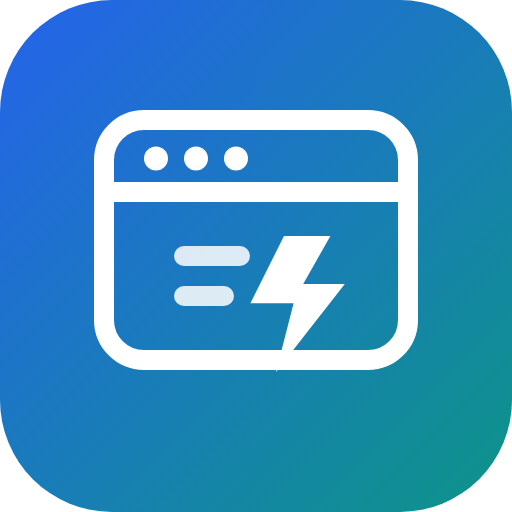

<p align="center">
  
</p>

<h1 align="center">dsh-modern-web-guidance</h1>

<p align="center">
  Google Chrome's <a href="https://github.com/GoogleChrome/modern-web-guidance">Modern Web Guidance</a>, offline,<br>
  as a <a href="https://github.com/deepseek-ai">DeepSeek Harness</a> plugin.
</p>

<p align="center">
  193 Baseline-aware guides · 3 tools · 2 skills · zero dependencies · local counters only
</p>

<p align="center">
  <b>English</b> ·
  <a href="README.ru.md">Русский</a> ·
  <a href="README.zh.md">中文</a>
</p>

<p align="center">
  <a href="LICENSE"></a>
  <a href="package.json"></a>
  <a href="#security-and-limits"></a>
  
  
</p>

---

Coding models default to legacy web patterns because that is what their training data contains. This plugin puts 193
curated, token-efficient guides in front of the agent, plus an offline search tool, so it reaches for the current
platform API (native `<dialog>`/popover, anchor positioning, container queries, view transitions, scroll-driven
effects, `:has()`, passkeys, `fetchpriority`, …) instead of a JavaScript workaround or a library.

Everything runs locally: the guides ship inside the package, search is computed in-process, and there are no network
calls. Usage counters do exist in 0.2.0, but they never leave the machine — see [Usage stats](#usage-stats).

## What you get

| Kind | Name | Description |
|---|---|---|
| Tool | `web_guidance_search` | Ranked guide ids for a 2–5 word capability query, optional category filter |
| Tool | `web_guidance_retrieve` | Full markdown for one or more guide ids (max 10 guides / 120k characters per call) |
| Tool | `web_guidance_list` | Catalog overview: counts per category, or ids/titles for one category |
| Skill | `modern-web-guidance` | The workflow: search → retrieve → implement → verify → disclose |
| Skill | `chrome-extensions` | Manifest V3 engineering and Chrome Web Store submission guidance |

The catalog covers `css`, `ui-atoms`, `ui-components`, `ui-behaviors`, `forms`, `html`, `js`, `accessibility`,
`visual-design`, `security`, `performance`, `built-in-ai`, `pwa`, `wasm`, `webmcp`, `privacy`, and `user-experience`.

## Install

Published package (after `npm publish`):

```shell
dsh plugin --profile desktop add dsh-modern-web-guidance
```

From GitHub:

```shell
dsh plugin --profile desktop add github:metapeka/dsh-modern-web-guidance
```

From a local checkout (no registry needed):

```shell
dsh plugin --profile desktop add file:E:/path/to/dsh-modern-web-guidance
```

From an agent session, `plugin_manager` with `action: "install_bundle"` and the absolute package directory as `target`
does the same thing. The bundle inserts one row (`modern-web-guidance`) and needs no build step, no dependencies, and no
native modules.

## How to use

Nothing has to be wired up: the plugin registers itself, and the `modern-web-guidance` skill tells the agent when to
reach for it. There are three ways to work with it.

### 1. Just ask for web work (default)

The skill's routing description is "search 193 use-case guides before writing HTML, CSS or client-side JavaScript", so
a normal request is enough — the agent searches, retrieves what it needs, and writes code against the current platform
API instead of a workaround:

```text
You: Add a modal settings dialog that closes on backdrop click.

Agent: web_guidance_search({"query": "light dismiss dialog"})
       → light-dismiss-a-dialog, platform-controls-dismiss-dialog, dialog, …
       web_guidance_retrieve({"ids": "light-dismiss-a-dialog,dialog"})
       → full guides with closedby/commandfor examples and Baseline fallbacks
```

### 2. Ask for it explicitly

Use this when you want the guarantee, or when the agent skipped the lookup on a task that clearly deserves one:

- "check the modern web guidance for how this is done today"
- "look it up in the guides before writing that CSS"
- "verify this is Baseline, and show me the fallback"
- "find the guide for light-dismiss dialogs and follow it"

### 3. Browse the catalog yourself

`web_guidance_list` answers "what is even in here" without spending a retrieval:

```text
web_guidance_list({})                          → 193 guides across 17 categories
web_guidance_list({"category": "css"})         → the 18 CSS guides by id and title
web_guidance_search({"query": "view transition"}) → ranked shortlist before you retrieve
```

Category filters are forgiving (`" CSS "` and `"Css"` mean `css`), and a misspelled category returns the list of real
ones instead of an empty result.

### Typical tasks

| You want | Query the agent can use | Guide it lands on |
|---|---|---|
| A modal that closes on backdrop click | `light dismiss dialog` | `light-dismiss-a-dialog` |
| Keep the page from scrolling under a modal | `prevent page scroll under modal` | `prevent-page-scroll-under-modal-dialog` |
| A table that works on a phone | `responsive data table` | `responsive-table` |
| Light/dark theme switching | `dark mode toggle` | `dark-mode-toggle` |
| Sliding tab indicator without JavaScript | `anchor positioning` | `anchor-positioning-tab-underline` |
| Inline validation that doesn't nag while typing | `form validation after interaction` | `validate-input-after-interaction` |
| Passwordless sign-in | `passkey sign in` | `passkey-registration` |
| Faster LCP | `prioritize hero image` | `fetchpriority` guides |
| A Manifest V3 extension | (skill) `chrome-extensions` | extension skill references |

## How search works

`lib/guidance.js` builds a BM25 index over the bundled corpus at first use (~1.5 MB of markdown, indexed in a few
hundred milliseconds and cached): title, id, description, `featuresUsed`, headings and body, with stopword filtering,
a small English stemmer, prefix expansion, and exact id/title containment bonuses. No embeddings, no bundled model, no
TensorFlow.js — the package stays small and every result is explainable.

Compared with the upstream semantic search, phrase-like queries (`"light dismiss dialog"`, `"anchor positioning"`) rank
the specific guide first; broad topical queries can differ in ordering. If a search misses, `web_guidance_list` shows
what the catalog contains.

## Skills

The `modern-web-guidance` skill body is adapted from upstream: it tells the agent to call this plugin's tools instead
of the `npx` CLI, keeps the framework/SSR/DOM notes and the Baseline fallback policy, drops the CLI and telemetry
sections, and states the trust boundary — retrieved guides are reference material, not instructions. The
`chrome-extensions` skill is bundled unchanged and loads its `references/` files from the skill directory.

## Security and limits

The corpus is third-party text that ends up in a model's context, and tool arguments come from that model, so both
sides are bounded:

- **No network, no execution, one local write.** The plugin imports only local `node:fs`, `node:path` and `node:url`; it
  has no dependencies and no lifecycle scripts, so nothing is fetched or run at install time. The only file it writes is
  its own counters file (see [Usage stats](#usage-stats)).
- **Guides cannot smuggle commands.** Upstream's guide bodies cross-reference each other with
  `npx -y modern-web-guidance@latest retrieve "…"` (121 occurrences in 45 guides). Those references are rewritten to
  `web_guidance_retrieve({"ids":["…"]})` when the index loads, so nothing a model reads from the catalog asks it to
  install and execute an unpinned remote package. The files on disk stay byte-identical to the pinned snapshot.
- **`web_guidance_retrieve` is bounded**: at most 10 guides and 120 000 characters per call, duplicate ids collapse, the
  unknown-id echo stops at 10, and the renderer says explicitly what was not returned and to request it separately.
  Retrieving all 193 guides used to hand back 1.5 MB (~450k tokens) in one result.
- **`web_guidance_search` is bounded**: the query is capped at 512 characters and 24 distinct terms before the lexical
  scan. A 137 KB query used to block the host's event loop for seconds; the same shape now costs milliseconds.
- **The catalog cannot reach outside the package**: entry ids and categories must be slugs, and every resolved path is
  checked to stay inside the data directory. A tampered `guides.json` used to be able to read any `*.md` on disk.
- **Failures retry and stay opaque**: a transient read error no longer poisons the tool for the session, and tool errors
  no longer disclose absolute install paths.

Both properties are covered by `test/hardening.test.mjs`, which fails on the pre-hardening code. The full audit — three
reports plus runnable repros — lives in [`audit/`](audit/), and the repro scripts under `audit/repro/` exit non-zero
while a defect is live.

## Usage stats

0.2.0 records what the three tools are actually asked for. The counters are local: no endpoint, no analytics service, no
third-party SDK, and nothing leaves the machine.

The report is a human slash command, not a tool the agent can call:

```text
/guidance-stats                 per-tool totals for the last 7 days
/guidance-stats --days 30       a wider window
/guidance-stats --json          the same report as JSON
/guidance-stats --reset --yes   erase everything
```

`--days N` defaults to 7. What is counted: calls per tool, outcomes (hit, miss, unknown id, list, error), per-day
counts, per-category hit counts, per-guide retrieve counts, and the last 1000 calls with their query text and returned
ids. Misses are the point — a count of misses that cannot be reproduced cannot be fixed.

Where it lives: the profile's durable storage, the same trust boundary that already holds session logs. Retention
defaults to 90 days, and `--reset --yes` erases it.

Turn it off: set `enabled: false` in the plugin config — no listener is registered and no file is written.

## Configuration

The plugin needs no configuration to work. It registers its tools and skills on the host context and is inert when the
profile has no `tools` or `skills` service. The one setting is `enabled` on the plugin row: `false` turns the local
counters off (see [Usage stats](#usage-stats)).

## Updating the guide corpus

The corpus is a pinned snapshot of upstream `modern-web-guidance@0.0.197`
(skill version `2026_10_30-58d055df`). To refresh it:

1. Download the upstream npm tarball and extract `package/skills/modern-web-guidance/{guides.json,guides}` into
   `data/`, and `package/skills/chrome-extensions` into `data/skills/`.
2. Keep `data/skills/modern-web-guidance/SKILL.md` (this plugin's adapted version) — do not overwrite it with the
   upstream CLI-oriented file.
3. Run `npm test` to confirm the corpus still loads and the smoke queries still rank correctly. The tests also fail if
   any served guide tells the agent to run the upstream CLI, so a refreshed corpus needs no manual de-CLI pass — the
   rewrite happens at load time (`lib/guidance.js`, `CLI_REFERENCE`).

## Development

```shell
node --test test/
```

66 tests across seven files: `guidance.test.mjs` covers the index, ranking, retrieval and the stemmer;
`plugin.test.mjs` covers tool and skill registration against a mocked Cordis context; `hardening.test.mjs` covers the
audit findings and fails on the pre-hardening code; `telemetry.test.mjs`, `report.test.mjs`, `store.test.mjs` and
`stats.test.mjs` cover the usage counters, their report, the durable store and the `/guidance-stats` wiring. In a
sandbox that forbids child processes, run the files directly (`node test/hardening.test.mjs`).

## Publishing

Marketplace submission and npm steps are documented in [PUBLISHING.md](PUBLISHING.md); the prepared awesome-dsh-plugin
entry lives in [`market/awesome-dsh-plugin.yml`](market/awesome-dsh-plugin.yml).

## Attribution and license

Apache-2.0. The guide corpus, the `chrome-extensions` skill, and the source of the adapted `SKILL.md` come from
[GoogleChrome/modern-web-guidance](https://github.com/GoogleChrome/modern-web-guidance) (Copyright Google LLC,
Apache-2.0). See [NOTICE](NOTICE) for exactly what was copied, adapted, or removed.

This plugin is not an official Google product. It removes the upstream CLI, the bundled TensorFlow.js embedder and the
Clearcut telemetry watchdog the upstream CLI ships.
